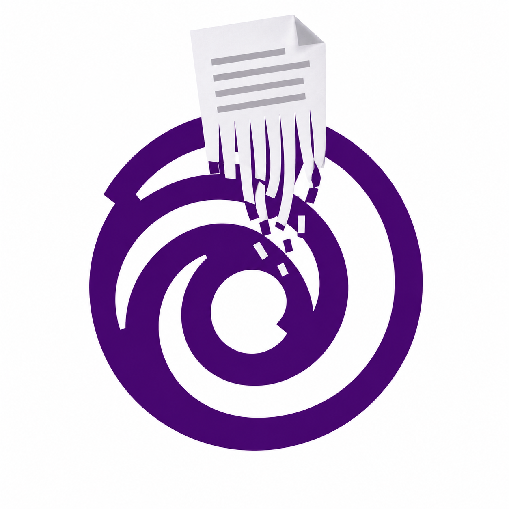

 

  
    

  
  
  
  

> [!CAUTION]
> **Use UbiSlot at your own risk. Always keep a backup of your Ubisoft achievement data before making changes. Do not abuse the usage of UbiSlot.**

---

## Overview

UbiSlot is a Windows application that lets you manage and unlock Ubisoft Connect achievements. It finds your Ubisoft games, displays their achievements, and lets you choose which achievements to unlock.

UbiSlot is currently in **beta testing**.

## Current Version

**UbiSlot `v0.4.0-beta`**

This version includes the Load feature where players can manually select the achievement file. However, UbiSlot still needs testing with more Ubisoft games and different installations. Some bugs or compatibility issues may remain.

---

## Features

- **Ubisoft Game Library:** Automatically finds Ubisoft games associated with your account.
- **Game Identification:** Identifies games and displays their correct names and covers.
- **Game Instance:** Handles game sessions, creates game instance including games that are already running.
- **Achievement Browsing:** View achievement names, descriptions, IDs, icons, and unlock status.
- **Achievement Selection:** Choose individual or every achievement to unlock.
- **Automatic Backups:** Creates permanent backups of achievement data before making changes.
- **Achievement Restore:** Restore the achievement data saved when you opened the current game session.
- **Automatic Update Checking:** Check for newer UbiSlot releases.

---

## Installation

Download the latest beta release from the [Releases](https://github.com/BalTor02/UbiSlot/releases) page.

1. Download the latest **UbiSlot ZIP**.
2. Extract the ZIP file.
3. Make sure **Ubisoft Connect** is installed, running and you are logged in.
4. Run **UbiSlot.exe**.
5. Wait for UbiSlot to scan your Ubisoft data and load your game library.

---

## How to use (Detailed)

1. Make sure **Ubisoft Connect is running and you are logged in**.
2. Make sure **no Ubisoft game is currently running in the background**.
3. Launch **UbiSlot** and wait for your game library to load. This may take a couple of minutes on some systems.
4. Select the game.
5. UbiSlot will start a game session.
6. In the Achievement Manager:
   - Use **Search** to find achievements by name or Achievement ID.
   - Use **Sort** to arrange achievements by Name, ID, Date Achieved, Locked, or Unlocked.
   - **Date Achieved** arranges unlocked achievements from oldest to newest.
   - Use **Select All Locked** to select all locked achievements.
   - Use the checkboxes to select individual achievements.
7. Click **Get Achievement** and confirm your selection. UbiSlot applies the selected changes immediately.
8. Keep the Achievement Manager open if you may need to use **Restore Original** during the same session.
9. Once the **Achievement Window is closed**, achievements would be synchronized immediately and **cannot be restored.**
10. Close UbiSlot before launching the game.

### Restore Original

**Restore Original** brings back the achievement data saved when you opened the game session. It removes the changes made by UbiSlot during that session. However, it **cannot lock achievements that have already been synchronized**.

---

## Important

UbiSlot changes achievement data stored locally by Ubisoft Connect. Changing achievement data may carry risks. UbiSlot does not bypass Ubisoft ownership, DRM, authentication, or server-side/multiplayer achievements. Avoid unlocking all achievements at once or starting multiple games in an instance. Once achievements have been synchronized, **UbiSlot cannot lock it again.** Game compatibility depends on my ownership. I do not own every single Ubisoft titles.

---

## Credits

**BalTor** — UbiSlot Developer

**NikitaGareev** — Uplay Game ID

**PSerban93** — Ubisoft achievement data extraction technique

---

## Support the Project

If UbiSlot has helped you unlock achievements or complete your games, consider supporting the project. Your feedback and support help the project reach more users and stay maintained. All funds go towards buying new titles and testing. You can also help by adding me to your Steam family.

### Ways to Support

- **⭐ Star this Repository:** Click the **Star** button at the top right of this page.
- **👤 Follow the Profile:** Follow [@BalTor02](https://github.com/BalTor02) for future projects and releases.
- **💖 Sponsor the Work:** Support UbiSlot's development and maintenance through GitHub Sponsors.

  

---

## Disclaimer

UbiSlot is an independent community project. It is not affiliated with, endorsed by, or sponsored by Ubisoft Entertainment.

Ubisoft, Ubisoft Connect, and related trademarks belong to their respective owners.

UbiSlot is provided for educational, archival, and personal-use purposes. Users are responsible for how they use the software and for following the terms and policies that apply to their Ubisoft accounts and games.

---

## FAQ

### 1. What is UbiSlot?

> UbiSlot is a Windows application that lets you manage and unlock Ubisoft Connect achievements.

### 2. Does UbiSlot use Steam?

> Not for achievements or game ownership. Steam is only used to find compatible game cover images.

### 3. Does UbiSlot modify my game files?

> No. UbiSlot works with Ubisoft's locally stored achievement data. It does not modify the main game installation files.

### 4. Where does UbiSlot get my games from?

> UbiSlot finds your games using ownership information stored locally by Ubisoft Connect. It then matches them with its included game database.

### 5. Do I need Ubisoft Connect installed?

> Yes. UbiSlot uses information stored by Ubisoft Connect, so it must be installed and running on your system.

### 6. Do I need to own the game?

> Yes. You must own a legitimate copy of the Ubisoft game, and it must be associated with your Ubisoft account. Cracked or pirated games are not supported.

### 7. Can I unlock all achievements at once?

> Yes, but this is **not recommended during beta testing**. It is safer to avoid unlocking all achievements at once.

### 8. Can UbiSlot lock an achievement again?

> **Restore Original** can bring back the achievement data saved when you opened the current session. However, it cannot lock achievements that have already been synchronized.

### 9. Can I unlock achievements for all the games?

> Yes, but do not unlock them back-to-back as that may result in soft lock of account. Take a break before launching next game.

### 10. Something isn't working. What should I do?

> First, make sure you have followed all the steps properly
> 
> If the problem continues, open a [GitHub Issue](https://github.com/BalTor02/UbiSlot/issues) and provide:
>
> - The Ubisoft game affected
> - Spool file ID
> - What actually happened
>
> **Do not upload personal Ubisoft account information or private files to a GitHub issue.**

---

## License

This project is licensed under the **MIT License**.

You are free to use, copy, modify, merge, publish, distribute, sublicense, and sell copies of the software, subject to the conditions of the MIT License.
